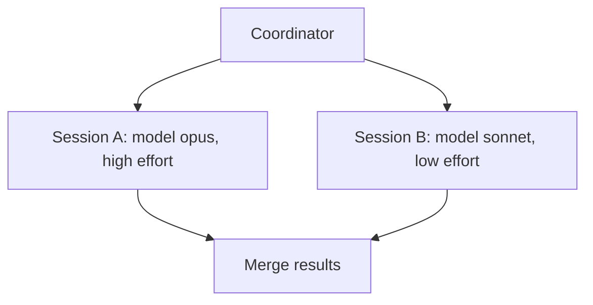

## Idea

Claude acts as orchestrator, delegating tasks to sub-sessions, each with its own **model** and **effort level**.

- [ ] Define skill frontmatter + invocation
- [ ] Model/effort routing rules
- [ ] Merge + report format

